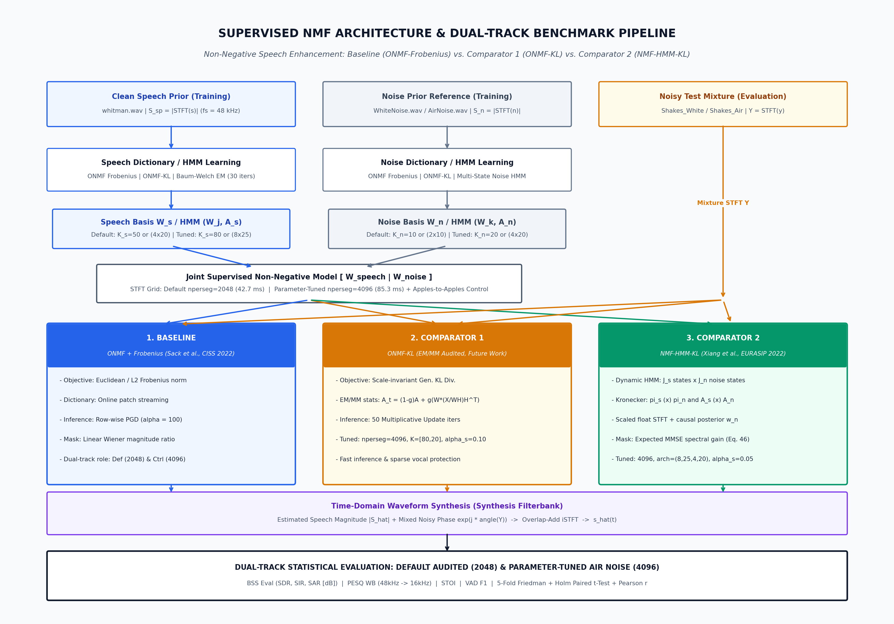

# NMF Speech Enhancement Benchmark

An apples-to-apples comparative benchmark of **supervised Non-Negative Matrix Factorization (NMF)** methods for **single-channel speech enhancement** (`fs = 48,000 Hz`) under stationary broadband Gaussian White Noise and non-stationary real-world Air Purifier noise (*Levoit-H132*).

> **Associated Paper:** *Link forthcoming (to be updated upon publication).*



---

## Benchmarked Methods

All three methods operate strictly within the **supervised prior-dictionary paradigm** trained on clean speech (`Data/audio/whitman.wav`) and isolated noise (`WhiteNoise.wav` / `AirNoise.wav`), evaluated on `shakespeare.wav` mixtures:

1. **Baseline — `ONMF-Frobenius`** *(Sack et al., IEEE CISS 2022)*: Online NMF with Euclidean (Frobenius) objective, patch streaming, and $\ell_1$-sparse projected gradient descent ($\alpha = 100$).
2. **Comparator 1 — `ONMF-KL`** *(Audited EM/MM Extension of Sack et al., Sec. 4)*: Scale-invariant Generalized Kullback-Leibler Divergence ONMF using exact online EM/MM sufficient statistics ($A_t, B_t$) and tunable speech activation sparsity ($\alpha_s$).
3. **Comparator 2 — `NMF-HMM-KL`** *(Xiang et al., EURASIP JASMP 2022)*: Dynamic multi-state Speech & Noise HMMs under Poisson/KL likelihoods, Kronecker state composition ($\bar{\boldsymbol{\pi}} \otimes \ddot{\boldsymbol{\pi}}, \bar{\mathbf{A}} \otimes \ddot{\mathbf{A}}$), causal forward posteriors, and Eq. (46) MMSE spectral gain.

---

## Dual-Track Evaluation Summary (`5-Fold Cross-Segmentation`, `fs = 48 kHz`)

| Noise Class | Method | Default Track (`nperseg=2048`)<br/>SDR (dB) / PESQ / STOI | Tuned Track (`nperseg=4096`)<br/>SDR (dB) / PESQ / STOI | Inference<br/>(s / fold) |
| :--- | :--- | :---: | :---: | :---: |
| **White Noise** | `Noisy Input` | `9.51` / `1.339` / `0.909` | — | — |
| | `Baseline (ONMF-Frobenius)` *(Def / Ctrl 4096)* | `22.72` / `2.526` / `0.887` | `21.45` / `2.110` / `0.856` | `2.65` / `1.44` |
| | `Comparator 1 (ONMF-KL)` | **`24.47`** / `3.010` / **`0.927`** | `23.33` / **`3.525`** / **`0.925`** | **`0.17`** / **`0.24`** |
| | `Comparator 2 (NMF-HMM-KL)` | `24.20` / **`3.036`** / **`0.927`** | **`23.34`** / `3.183` / **`0.925`** | `0.40` / `2.08` |
| **Air Noise** | `Noisy Input` | `5.65` / `1.407` / `0.710` | — | — |
| | `Baseline (ONMF-Frobenius)` *(Def / Ctrl 4096)* | **`10.17`** / `1.777` / `0.746` | `10.99` / `1.813` / `0.754` | `3.60` / `1.71` |
| | `Comparator 1 (ONMF-KL)` | `9.28` / `1.682` / `0.743` | **`11.00`** / `1.972` / **`0.778`** | **`0.17`** / **`0.19`** |
| | `Comparator 2 (NMF-HMM-KL)` | `10.05` / **`1.858`** / **`0.756`** | `10.84` / **`2.051`** / `0.774` | `0.40` / `1.79` |

Key takeaways:
- **`ONMF-KL`** eliminates `ONMF-Frobenius` latency bottlenecks (`~0.17–0.24 s/fold` vs. `1.44–3.60 s/fold`), leads Default White Noise SDR (`24.47 dB`), and—when tuned with `nperseg=4096, K=[80,20], alpha_s=0.10`—achieves the **highest Air Noise SDR (`11.00 dB`)**, **highest Air Noise STOI (`0.778`)**, **highest White Noise PESQ (`3.525`)**, and lowest Air Noise false-positive silence leakage (`VAD F1 = 0.948–0.951`).
- **`NMF-HMM-KL`** achieves the **highest perceptual PESQ on non-stationary Air Noise** in both Default (`1.858`) and Tuned (`2.051`) tracks by tracking sequential phoneme state transitions instead of aggressively attenuating overlapping low-frequency bands.

---

## Repository Structure

```text
.
├── 01_baseline_replication.ipynb         # End-to-end replication of Sack et al. (2022)
├── benchmarks/
│   ├── 02_comparative_experiments.ipynb  # Dual-track full-clip runs, spectrograms & audio demos
│   ├── 03_statistical_analysis.ipynb     # 5-fold evaluation, Friedman, Holm t-Test, Pearson r, VAD & validation curves
│   ├── generate_architecture_diagram.py  # Reproducible matplotlib architecture flowchart generator
│   ├── figures/                          # Publication figures & diagnostic plots
│   └── audio_output/                     # Separated .wav outputs for Baseline, ONMF-KL, and NMF-HMM-KL
├── Data/
│   ├── audio/                            # Clean speech, noise priors, and noisy mixtures (fs = 48 kHz)
│   └── audio_output/                     # Precomputed & replicated baseline waveforms
├── onmf.py                               # Core Online NMF module (Lyu et al., 2020)
├── dictionary_learner.py                 # Patch-based ONMF dictionary learning wrapper
├── audio_enhancement.py                  # Sparse-coding separation and Wiener mask synthesis
├── main.py                               # Baseline CLI script (with scikit-learn>=1.2 compatibility fix)
├── performance.py                        # BSS Eval (SDR, SIR, SAR) calculation module
├── deviation_notes.md                    # Audit log of upstream bugs, API fixes & seed determinism
├── experiment_log.txt                    # Hardware, runtime dependencies, and hyperparameter configurations
├── requirements.txt                      # Python package requirements
├── README_BASELINE.md                    # Original upstream repository README
└── LICENSE                               # MIT License
```

---

## Quick Start

1. **Install dependencies** (tested on Python 3.13.0):
   ```bash
   pip install -r requirements.txt
   ```
2. **Run notebooks in order**:
   - [`01_baseline_replication.ipynb`](01_baseline_replication.ipynb) — Reproduces the `NMF` and `ONMF` baseline tables and spectrograms.
   - [`benchmarks/02_comparative_experiments.ipynb`](benchmarks/02_comparative_experiments.ipynb) — Runs Default (`2048`) and Tuned (`4096`) comparisons across `ONMF-Frobenius`, `ONMF-KL`, and `NMF-HMM-KL`.
   - [`benchmarks/03_statistical_analysis.ipynb`](benchmarks/03_statistical_analysis.ipynb) — Generates 5-fold statistical significance tests, correlation analyses, VAD confusion matrices, boxplots, and validation curves.
3. **Regenerate the architecture diagram** *(optional)*:
   ```bash
   python benchmarks/generate_architecture_diagram.py
   ```

---

## References & Acknowledgments

- **Baseline Paper & Upstream Code**: Andrew Sack, Wenzhao Jiang, Michael Perlmutter, Palina Salanevich, and Deanna Needell, *"On Audio Enhancement via Online Non-negative Matrix Factorization"*, IEEE CISS 2022 ([arXiv:2110.03114](https://arxiv.org/abs/2110.03114)); upstream implementation `Jerry-jwz/Audio-Enhancement-via-ONMF` (preserved in [`README_BASELINE.md`](README_BASELINE.md)).
- **Core ONMF Algorithm**: Hanbaek Lyu, Georg Menz, Deanna Needell, and Christopher Strohmeier, *"Applications of online nonnegative matrix factorization to image and time-series data"*, IEEE ITA Workshop, 2020 ([IEEE Xplore](https://ieeexplore.ieee.org/document/9245004), [GitHub](https://github.com/HanbaekLyu/ONMF_ONTF_NDL.git)).
- **Temporal HMM-NMF Comparator (`NMF-HMM-KL`)**: Xiang et al., *EURASIP Journal on Audio, Speech, and Music Processing* (2022).
- **License**: Released under the MIT License ([`LICENSE`](LICENSE)).
